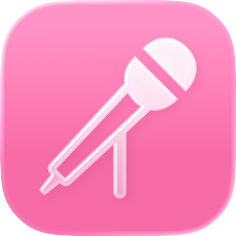
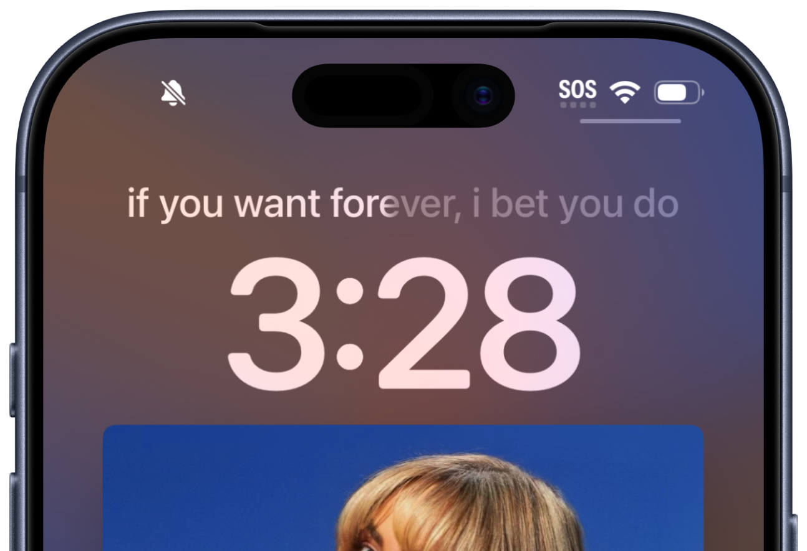

# DateLyrics 🎵
### Song lyrics in the Lock Screen date view!

DateLyrics brings song lyrics to the Lock Screen date view, with word-by-word highlighting when available. Now supports Apple Music, Spotify, YouTube and other apps with synchronized lyrics from Musixmatch, LRCLIB, Megalobiz, NetEase, and QQ Music.

---

<table align="center">
  <tr>
    <td align="center">
      <picture>
        <source media="(prefers-color-scheme: dark)" srcset="DateLyricsIconDark.png">
        
      </picture>
    </td>
    <td align="center">
      
    </td>
  </tr>
</table>

---

## Compatibility

DateLyrics supports any **rootless jailbreak** on iOS 16.0 and later. Users running semi-jailbreaks such as **NathanLR** will need to inject tweaks into the Music application in order for DateLyrics to work.

Download the latest version from **[Releases](https://github.com/shalamand3r/DateLyrics/releases)** or **[Add my Sileo Repo](https://shalamand3r.github.io)**

---

  

## Playback, offline lyrics and external apps

DateLyrics follows playback without changing song speed or the scrubber position.
Downloaded lyrics are cached for offline use; uncached songs need a network
connection, and older cache entries may be pruned. Uninstall removes caches and
logs while keeping your preferences.

Supports **Apple Music**, **Spotify**, **YouTube**, and other apps using synchronized lyrics from Musixmatch, LRCLIB, Megalobiz, NetEase, and QQ Music.

Musixmatch, QQ Music, and NetEase can provide word timing when available. The first usable lyrics appear immediately; later services can upgrade line timing to word timing, following your service order.

Native Apple lyrics stay in Music's private cache. Other apps use DateLyrics' shared
storage and do not need Music installed. Removing Music may remove its native
lyric cache; external-app caches remain separate.

Reset Settings keeps saved lyrics. Wipe Lyrics Cache removes downloaded lyrics
while keeping settings, logs and anonymous tokens.

## LyricBridge companion

[LyricBridge](LyricBridge/README.md) is a separate tweak for Apple Music’s native lyrics view. It works without DateLyrics. The two tweaks share [CoreLyrics](CoreLyrics/README.md) for online sources, matching and offline downloads, with separate Enabled switches.

LyricBridge and CoreLyrics are maintained in separate repositories, linked here as Git submodules. After cloning, run `git submodule update --init --recursive` before building. With Theos configured, build with `make package FINALPACKAGE=1`. Development scripts and tests are maintained on dev.

DateLyrics 4.0.9 requires CoreLyrics 1.0. Package managers install it as a dependency. Existing provider settings and tokens stay in the same shared settings domain, so LyricBridge and DateLyrics use the same source order, matching and timeout options.

CoreLyrics owns downloaded provider lyrics. Migration preserves old caches for adoption and never removes them just to upgrade. DateLyrics still keeps Apple exports and display/preview files in its own directory. Removing DateLyrics leaves the shared library cache available to LyricBridge.
